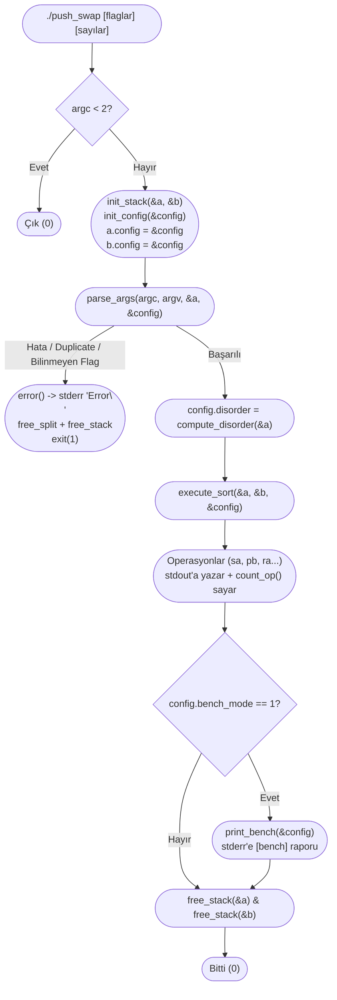
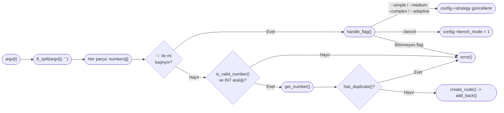
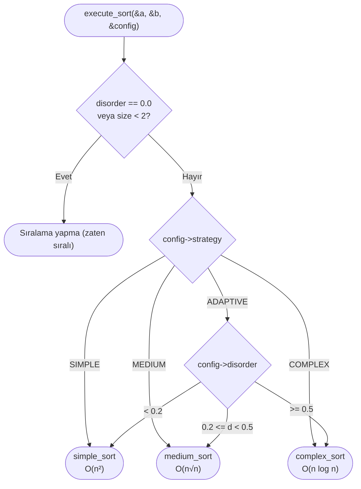

# Push_swap — Proje İş Akışı ve Mimari Rehberi

Bu belge, **Ali (`mmetin`)** ve **Emirhan (`emirhyil`)** tarafından geliştirilen `push_swap` projesinin uçtan uca çalışma akışını, modüller arası bağlantıları ve iki geliştiricinin birbirinin kodunu kolayca anlayabilmesi için katman özetlerini içerir.

---

## 1. Genel İş Akışı (Uçtan Uca)

Program çalıştırıldığında veri `push_swap.c` (`main`) üzerinden şu sırayla akar:

---

## 2. Ali'nin Katmanı (`mmetin`) — Girdi, Config, Sayaç & Benchmark

Bu katman dış dünyadan gelen argümanları temizler, kurallara göre doğrular, çalışma modunu (`t_config`) ayarlar, her hamleyi sayar ve istenirse `stderr`'e benchmark raporu basar.

### Parsing & Flag Akışı

### Dosya ve Fonksiyon Özeti (Ali'nin Alanı)

| Dosya | Sorumluluk | Önemli Fonksiyonlar |
|---|---|---|
| `push_swap.c` | Programın giriş noktası ve akış koordinasyonu | `main` |
| `init_config.c` | `t_config` yapısını varsayılanlara (`ADAPTIVE`, `0`) çeker | `init_config` |
| `parsing.c` | `argv` elemanlarını bölüp doğrulama döngüsünü yürütür | `parse_args`, `validate_args` |
| `parsing_utils.c` | Sayı/taşma kontrolü, `atoi`, duplicate kontrolü, flag okuma | `is_valid_number`, `get_number`, `has_duplicate`, `handle_flag` |
| `ft_split.c`, `ft_strcmp.c` | Boşlukla ayrılmış string bölme ve flag karşılaştırma | `ft_split`, `ft_strcmp` |
| `execute_sort.c` | Bayrağa veya `disorder` oranına göre sıralamayı başlatır | `execute_sort`, `run_adaptive` |
| `count_op.c` | Yapılan her hamleyi `op_count` ve `total_operations`'a işler | `count_op` |
| `bench_print.c`, `bench_utils.c` | `--bench` açıksa `stderr` (`fd = 2`)'ye `[bench]` raporu basar | `print_bench`, `putstr_err`, `putnbr_err`, `print_op_err` |
| `free_operations.c`, `error_operations.c` | Bellek temizliği ve hata durumunda güvenli çıkış | `free_stack`, `free_split`, `error` |

---

## 3. Emirhan'ın Katmanı (`emirhyil`) — Stack Motoru & Sıralama Algoritmaları

Bu katman Stack A'daki sayıları en az hamleyle sıralamaya odaklanır. Sayıların `argv`'den nasıl geldiğini veya `--bench` flag'inin açık olup olmadığını bilmesine gerek yoktur; sadece 11 temel stack operasyonunu kullanır.

### Strateji Seçimi ve Sıralama Akışı

### Algoritmalar Nasıl Çalışıyor? (Emirhan'ın Alanı)

| Dosya | Algoritma / Görev | Nasıl Çalışır? |
|---|---|---|
| `simple_sort.c` | **Simple Sort** — $O(n^2)$ | `find_min_position` ile en küçük elemanı bulur, `move_min_to_top` (`ra` / `rra`) ile üste taşır, `pb` ile Stack B'ye atar; sonunda `pa` ile A'ya geri toplar. |
| `medium_sort.c` | **Medium Sort** — $O(n\sqrt{n})$ | Önce `assign_indices` ile sayılara `0..N-1` sıralı indeks verir. `get_chunk_size` ile parça (chunk) boyutu belirler, `push_chunks` ile B'ye dağıtır, sonra `find_max_position` & `move_max_to_top` ile en büyükten küçüğe A'ya geri alır. |
| `complex_sort.c` | **Complex Sort** — $O(n \log n)$ | `assign_indices` sonrası **Radix Sort (bit tabanlı)** uygular: `get_max_bits` kadar bitleri gezer, biti `0` olanları `pb` ile B'ye atar, `1` olanları `ra` ile döndürür, ardından `pa` ile geri toplar. |
| `adaptive_sort.c` | **Adaptive Sort** | `compute_disorder` oranına bakıp `< 0.2` için Simple, `< 0.5` için Medium, `>= 0.5` için Complex çağırır. |
| `index_utils.c` | **İndeksleme** | Her düğüme kendisinden küçük eleman sayısını sayarak `0..N-1` arası `index` atar (negatif/büyük sayıları normalize eder). |
| `stack_utils.c` | **Stack Yardımcıları & Disorder** | Çift yönlü bağlı liste ekleme/çıkarma (`add_back`, `add_front`, `pop_front`, `pop_back`) ve `compute_disorder`. |
| `*_operations.c` | **11 Temel Operasyon** | `sa/sb/ss`, `pa/pb`, `ra/rb/rr`, `rra/rrb/rrr` — stack'i günceller, `stdout`'a hamleyi yazar ve `count_op` çağırır. |

---

## 4. İki Katman Birbirine Nasıl Bağlanır? (Köprü Noktaları)

Birbirinizin kodunu bozmadan çalışmanızı sağlayan **3 temel köprü** vardır:

1. **`t_stack.config` Pointer'ı:**
   `main` içinde `a.config = &config; b.config = &config;` bağlanır. Emirhan'ın algoritmaları sadece `sa(a)` veya `pb(a, b)` çağırır; operasyon fonksiyonları içindeki `count_op(stack, OP_...)` arka planda `config->op_count` ve `config->total_operations`'ı otomatik artırır. (`test_main.c` gibi `config` bağlanmayan testlerde `stack->config == NULL` olduğu için `count_op` güvenle hiçbir şey yapmadan döner.)
2. **`stdout` vs `stderr` Ayrımı:**
   Operasyonlar her zaman **`stdout` (`fd = 1`)**'a yazılır (`sa\n`, `pb\n`...), böylece `./push_swap ... | ./checker` sorunsuz çalışır. `--bench` raporu ise yalnızca **`stderr` (`fd = 2`)**'ye `[bench]` ön ekiyle basılır.
3. **`execute_sort`:**
   Ali'nin `parse_args` ile belirlediği `config->strategy` ve `compute_disorder` sonucunu alıp Emirhan'ın uygun sıralama fonksiyonuna (`simple_sort`, `medium_sort`, `complex_sort`) yönlendirir.
